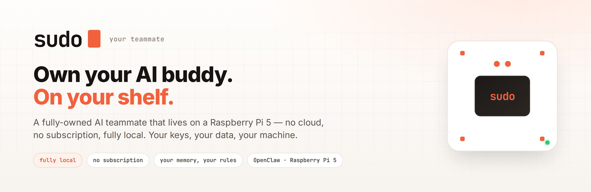
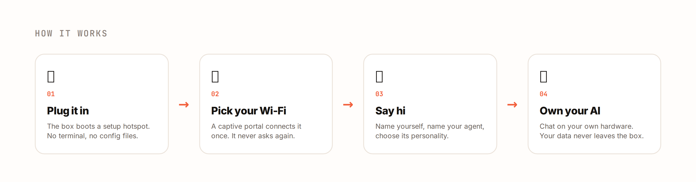

<div align="center">
  
</div>

<div align="center">

**A fully-owned AI teammate that lives on a Raspberry Pi 5.**
Local by default. No subscription. Your keys, your data, your machine.

[Website](https://sudospace.tech) · [Instagram](https://instagram.com/sudospace.tech) · [Early access](https://sudospace.tech)


</div>

---

## What is this?

`sudo` is a physical AI teammate that lives on a Raspberry Pi on your shelf — **OpenClaw, without the maintenance tax**. Self-hosting an AI agent normally means cryptic configs, broken dependencies, and constant updates. `sudo` packages all of that into a plug-and-play box: buy it, plug it in, name it, talk to it.

> **Ownership without the CS degree.**

Everyone will be able to *use* an agent. The durable value is *owning* one — your keys, your data, your machine, your model choice. `sudo` makes that as easy as the cloud incumbents — and it's yours, whether you run a local model or plug in a cloud one.

<div align="center">
  
</div>

---

## Features

- 🏠 **Local by default** — the agent runs on your box, and your memory lives on-device.
- 🔒 **Private by default** — your memory, your rules.
- 💳 **No subscription required** — buy the box, own the agent.
- 🧠 **Your choice of model** — run a local model offline, or connect a cloud model *only if you want*.
- 🤖 **Multi-bot** — several agents in one chat.
- 📊 **Local dashboards** — the private apps your agent can run.
- 💬 **Real connectors** — WhatsApp, email, and text, out of the box.
- ⚙️ **One-tap updates** — you decide when, and what stays.

---

## How it works

1. **Plug it in** — the box boots a setup hotspot. No terminal, no config files.
2. **Pick your Wi-Fi** — a captive portal connects it once. It never asks again.
3. **Say hi** — name yourself, name your agent, choose its personality.
4. **Own your AI** — chat on your own hardware. Your memory stays on the box; connect a cloud model only if you want to.

> "This is when it stops feeling like a tool and starts feeling like a teammate."
>
> "Full ownership unlocks freedom. Imagination becomes the limit."

---

## Install it on your own Pi

**You need:** a Raspberry Pi 5 (4 GB or more) with its power supply, a microSD card (16 GB or more), and a Mac, Linux or Windows computer with an SD card reader.

1. **Flash Raspberry Pi OS.** Use [Raspberry Pi Imager](https://www.raspberrypi.com/software/) and pick **Raspberry Pi OS (64-bit)**. You don't need to set up Wi-Fi in Imager; sudo does that itself.
2. **Download this repository** (green **Code** button → **Download ZIP**, or `git clone`) and unzip it.
3. **Put sudo on the card.** With the card still in your computer, open a terminal in the downloaded folder and run the line for your computer:

   ```bash
   # macOS
   bash raspi-factory/prepare-sd.sh /Volumes/bootfs
   # Linux
   bash raspi-factory/prepare-sd.sh /media/$USER/bootfs
   # Windows (Git Bash) — use your card's drive letter
   bash raspi-factory/prepare-sd.sh /d
   ```

   It downloads two small programs, copies sudo onto the card and sets it to install itself on first boot. Copying the repository onto the card by hand does nothing: this script is what makes the Pi install it.
4. **Eject the card safely**, put it in the Pi and plug in power. The first boot sets things up and restarts on its own; give it 2–5 minutes.
5. **On your phone, join the Wi-Fi called `Sudo Setup`** (open, no password). The setup page opens by itself, or go to <http://192.168.4.1/>. Pick your home Wi-Fi, save sudo's address, and follow the steps.

The first setup downloads the agent, which can take 10–15 minutes. After that, updates install from **Settings → Updates**.

**Something wrong?** If `Sudo Setup` doesn't appear after 5 minutes, put the card back in your computer: `firstrun.log` and `hotspot.log` on it say what happened.

---

## Repository layout

```
raspi-factory/        Factory image builder + on-device runtime
├── sudo-dashboard/   On-device web dashboard (Python, no build step)
├── sudo-pi/          First-boot installers + configurators
├── wifi-setup/       Captive-portal Wi-Fi onboarding
├── openclaw/         OpenClaw base config, model list, agent templates + sudo plugins
└── whatsapp-bridge/  WhatsApp connector
design/               Design references
assets/               README visuals
```

**The agent brain is [OpenClaw](https://openclaw.ai).** On first boot the device installs OpenClaw (prebuilt arm64 bundle on the card, or npm). Until it's in, the chat says the agent is setting up; if the install ever gives up, the dashboard offers a Retry.

---

## Status

🚧 **Active development — early access.** 9 beta testers running it now; piloting with schools. Get in touch via [sudospace.tech](https://sudospace.tech) or [@sudospace.tech](https://instagram.com/sudospace.tech).

---

<div align="center">
<sub>Two continents, one small purple guy.</sub>
</div>
